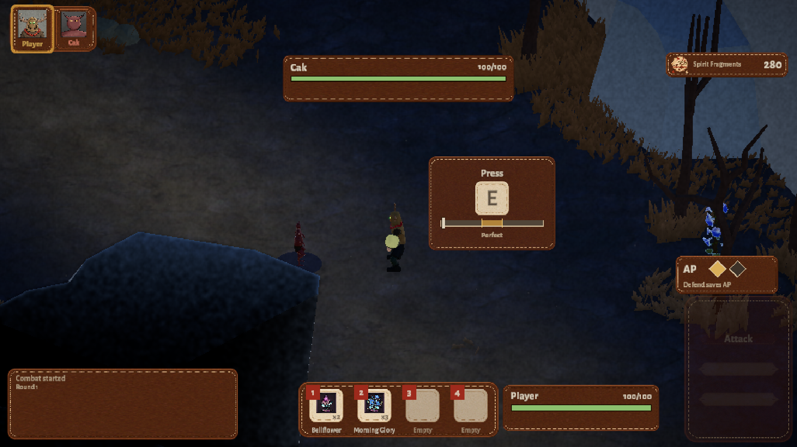
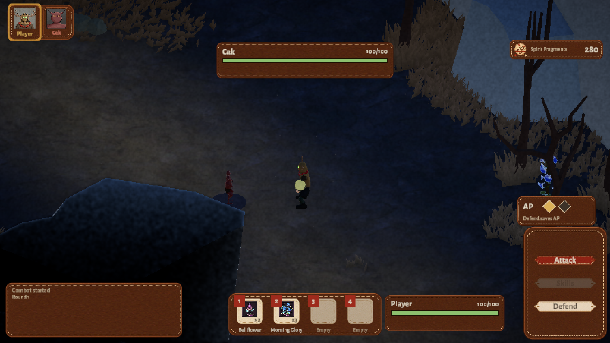
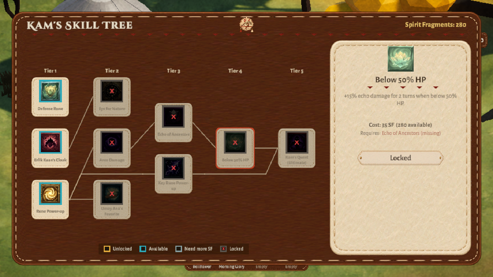
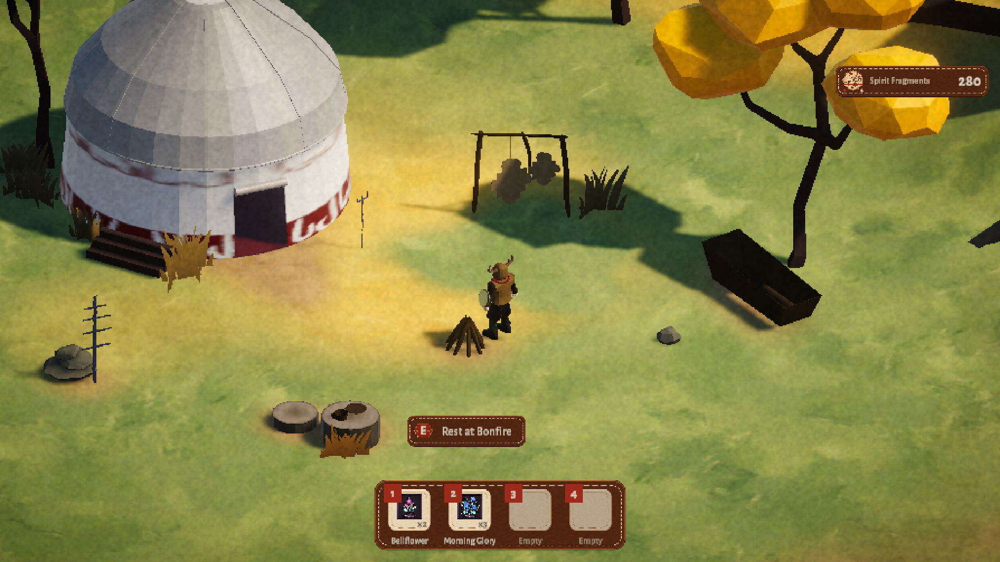

# KAM — Design Case Study

**KAM** is an isometric, turn-based roguelite RPG set in Turkish mythology. You play
Göktay, the shaman (*kam*) of his Oba, who enters the Spirit Realm to recover a soul
taken by evil spirits. You sneak past or fight spirits in turn-based battles where
timing matters as much as choice, then return to the village to grow stronger.

**Genre:** turn-based roguelite RPG · **Platform:** Windows ·
**Tech:** Unity 6 (6000.4), C#, URP, Input System, Cinemachine
**Context:** graduation project, Istanbul Bilgi University · team of five · two semesters

- **Full case study:** https://kaaneskikalci.com/dev/kam/
- **Play it:** https://kaaneskikalci.itch.io/kam

> This mirror is the 9 June 2026 graduation build. A post-graduation polish round
> (Nov 2026: clearer combat feedback, progress-loss fixes, one visual style, a 3D start
> menu) is described at https://kaaneskikalci.com/dev/kam; the itch.io page has both
> builds.

---

## Media

Screenshots from the Nov 2026 polish build.

| | |
|---|---|
|  |  |
| Timed-hit rune prompt with the Perfect zone marked | Combat HUD: turn order, HP, AP and actions |
|  |  |
| Skill tree with the detail panel open | The Oba hub |

## Design question and goals

> **How do you keep turn-based combat tactically interesting and physically engaging,
> while keeping the whole thing small enough for one main developer to build and maintain
> in two semesters?**

Turn-based combat can turn into a menu you click through, and a roguelite makes that
worse by repeating the same encounters run after run. The systems had to reward
thinking *and* stay active moment to moment, without growing past what one main
developer could finish.

**Goals**

1. **A complete loop, not isolated mechanics:** explore, fight, collect, save, unlock,
   die, return stronger.
2. **Combat where a turn is a decision, not a reflex.**
3. **A framework that accepts new items, enemies, skills and interactables** without
   rewriting core systems.

**Constraints:** one main developer for most of the gameplay code across two semesters; a
five-person team whose art, narrative and audio work depended on those systems being
ready; a scope that had to ship as a graduation project, not a wishlist.

## Core loop

**Run structure.** Oba (hub) → Spirit Realm portal → explore, loot, fight → rest at
bonfires → die or return → spend Spirit Fragments on the skill tree → go again.

- Temporary items are cleared when a run starts and when you return to the Oba;
  Spirit Fragments and skill unlocks are kept.
- On death you respawn at the last bonfire and lose **50% of carried Spirit
  Fragments**. With no bonfire saved, you fall back to the Oba.

**Turn structure.** Combat starts when a roaming enemy spots you; nearby enemies join.
Turn order is recalculated every round from effective speed, and some enemies charge
up and act only every *N* turns. On the player's turn:

- Gain **1 AP**; up to **2 AP** can be banked.
- Basic Attack costs 1 AP and triggers a timed-hit rune.
- **Defend is free**: it raises a shield and keeps your AP for next turn.
- Bigger skills, such as Echo of Ancestors (2 AP), need a banked turn first.

**Progression.** Spirit Fragments drop from enemies, chests and pickups. You spend
them at the Skill Tree Altar in the Oba. The tree has 10 skills in five tiers, ending
in an ultimate, and four of the skills make you choose one of two branches.

## Key systems

### 1. Timed-hit runes
A directional rune appears during an attack: press the matching arrow within the
**1.0 s** window for **Success (×1.3)**, or at its centre for **Perfect (×1.5)**. After
three hits in a row the window shrinks toward a minimum, so streaks get harder. This
keeps a menu-driven fight from becoming automatic. The rune doesn't own the damage: it
returns miss / success / perfect and combat interprets the result, which is what lets
skill-tree upgrades change timed-hit outcomes without touching combat code. Tuning is
a ScriptableObject, not code. In playtesting it was the highest-rated feature (see
[Status and lessons learned](#status-and-lessons-learned)).
→ [`Combat/TimedHit/`](Assets/Scripts/Combat/TimedHit) ·
[`TimedHitConfig.asset`](Assets/ScriptableObjects/TimedHitConfig.asset)

### 2. Action Points and the free Defend
Defend costs no AP, so it banks AP for next turn: give up damage now to afford a bigger
move later. Underneath is one rule: **a failed action must not spend AP or end the
turn** — execution is validated before anything is consumed.
→ [`CombatAction.cs`](Assets/Scripts/Combat/Actions/CombatAction.cs) ·
[`DefendAction.cs`](Assets/Scripts/Combat/Actions/DefendAction.cs) ·
[`PlayerStats.cs`](Assets/Scripts/Core/Stats/PlayerStats.cs)

### 3. Readable turn order and enemy intent
Speed sets turn order and buffs/debuffs re-sort it. Enemies show their next intent and
the HUD previews damage, so combat is planned, not guessed. Combos reward consecutive
attacks and break when you take damage or defend.
→ [`TurnSystem/`](Assets/Scripts/Combat/TurnSystem) ·
[`EnemyIntent.cs`](Assets/Scripts/Core/Combat/EnemyIntent.cs) ·
[`ComboSystem.cs`](Assets/Scripts/Combat/ComboSystem.cs) ·
[`UI/Combat/`](Assets/Scripts/UI/Combat)

### 4. Branching skill tree as a data layer
Each skill is a `SkillNode` asset with cost, tier, prerequisites and optional
branches (e.g. Rune Power-up → *Blinding* or *Life Steal*). Systems don't hardcode
bonuses; they ask a central `SkillEffectApplier` whether an effect is active, so adding
a skill doesn't mean editing combat. Some skills reach into exploration: Erlik Kaan's
Cloak shrinks enemy vision, Eye for Nature makes collectibles glow.
→ [`Progression/`](Assets/Scripts/Progression) ·
[`ScriptableObjects/Skills/`](Assets/ScriptableObjects/Skills)

### 5. Bonfires and a persistent world
Bonfires save and heal. Opened shortcuts and defeated bosses persist through a shared
`ISaveable` interface: death costs Fragments, but the map you opened stays open.
→ [`SaveSystem/`](Assets/Scripts/SaveSystem) ·
[`PersistentShortcut.cs`](Assets/Scripts/Interaction/Interactables/PersistentShortcut.cs)

## My role

**Main Developer · Systems Design.** Team of five. I was the team's main developer: I
wrote most of the gameplay code and designed most of the systems behind the core loop.
A teammate contributed to the skill tree and to the UI and enemy audio scripts. I
shared the game design with Kağan Samesti and Bora Kılıç. The rest of the team: Derin
Su Kutaydın and Ethem Anıl Göl.

The design decisions below were mine. One principle runs through them: no system
should have to know how another one works.

- **A failed action costs nothing.** The decision that mattered most in the AP system
  was the failure case: a failed action must not spend AP or end the turn, so
  execution is checked before anything is consumed. That is what turned Defend into a
  way to bank AP for a stronger play next turn, so turns differ instead of repeating.
- **Timed hits that don't own the damage.** I kept the rune out of the damage logic
  on purpose, so input timing, UI and damage stayed separable.
- **One shared unit model.** Player and enemies run on one `CombatUnit`, and a central
  turn manager owns turn order and win/lose resolution, so a combat result fires
  exactly once.
- **Query skill effects, never hardcode them.** Adding a skill doesn't mean editing
  combat.
- **One interaction flow for every object.** Chests, bonfires, portals, pickups and the
  skill-tree altar share one detector and one prompt; each object only defines what it
  does when used.

On the process side, we ran a 24-person playtest; only part of the action plan it
produced reached the final build (see below).

The game design document: [KAM GDD (PDF)](https://kaaneskikalci.com/files/kam-gdd.pdf).

## Status and lessons learned

**Status.** The final build is a complete roguelite loop: hub, run, tactical
turn-based combat, permanent progression, persistent world state and a
save/death/respawn flow, built by a single main developer within the two-semester deadline.
Play it on [itch.io](https://kaaneskikalci.itch.io/kam).

**Playtest — 19 May 2026, 24 participants.** We asked about pacing, the rune mechanic,
skill-tree build-crafting, balance and audiovisual feel.

| Measure | Score (out of 5) |
|---|---|
| Rune / timed hit | **3.73** — highest rated |
| Overall enjoyment | 3.66 |
| Visual aesthetics | 3.50 |
| Replayability | 3.41 |
| Skill tree | 3.39 |
| Sound design | 3.37 |
| Controls | 3.33 |
| UI clarity | **2.91** — lowest rated |

- **The timed hit was the right bet.** The assumption that players want an active
  moment inside a turn-based system held up under test.
- **The UI was undermining systems players otherwise liked.** Only 58.3% found the
  exploration-to-combat transition fluid. The skill tree scored only middling because players
  were fighting the interface to spend points, not because they disliked the skills.
  One tester rated the rune and skill tree 5/5 and still called the game unbalanced,
  because the UI never explained why they died. Unclear feedback doesn't read as
  "confusing"; it reads as "unfair".

**What changed.** The playtest produced a three-part action plan; only part of it
made it into the final build (9 June 2026):

1. **UI/UX overhaul (top priority):** the plan was to make combat state (HP, AP,
   turn order) readable at a glance and rework the skill-tree layout. It was still
   on the to-do list on the build date; it was taken up later, in the Nov 2026
   polish round.
2. **Exploration-to-combat transition:** a fade now covers the scene transition.
3. **Encounter balance:** Spirit Fragment loss on death became adjustable and chest
   fragment rewards grew to 300–500.

Alongside those, guards now stop music and result sounds from repeating. No playtest
was run after these changes, so their effect is untested.

Because timed hits, skill effects and interactions were modular, this meant changing
presentation and tuning values, not rewriting combat.

**What I learned.** The decisions that cost me most were the ones I made before I
understood the problem; the ones that saved me were the ones that refused to hardcode.
What I'd do differently is test earlier: we had working combat long before 24 people
played it, and a five-person playtest would have caught the UI problem months sooner.
Building the systems was the part I already knew how to do; learning that the
interface, not the mechanics, was the bottleneck is what I took with me.

More detail, plus the GDD and playtest reports, in the
[full case study](https://kaaneskikalci.com/dev/kam/).

## Repository guide

A **code-only mirror**: C# source, ScriptableObject data and project settings. Art,
audio, animation, scenes and prefabs belong to teammates or third parties and are not
included, so it won't open as a playable project — play via itch.io. The GDD isn't
here, but code comments cite its sections (e.g. *GDD 1.7.5*).

| Path | Contents |
|---|---|
| `Assets/Scripts/Combat` | Turn manager, turn order, actions, combos, timed-hit runes |
| `Assets/Scripts/Core` | Game state (hub ↔ run), combat units, stats, status effects, enemy intent |
| `Assets/Scripts/Progression` | Skill tree data, unlock state, skill-effect query layer |
| `Assets/Scripts/Hub` | Oba hub, Spirit Realm portal, skill-tree altar |
| `Assets/Scripts/SaveSystem` | Bonfire saves, death penalty, persistent world state |
| `Assets/Scripts/Inventory` | Inventory, quick slots, loot tables, items, plants |
| `Assets/Scripts/Interaction` | Interactables: chests, lore objects, shortcuts |
| `Assets/Scripts/KaanEnemyandBattle1` | Enemy roaming, vision, state machine, battle entry |
| `Assets/Scripts/KaanMovementAndCamera1` | Player movement, isometric camera |
| `Assets/Scripts/UI` | Combat HUD, skill tree, inventory, menus, feedback |
| `Assets/Scripts/Editor` | Editor setup helpers for combat, UI, skill tree, inventory |
| `Assets/ScriptableObjects` | Skill, item, plant and timed-hit data |

## Licence

MIT — see [LICENSE](LICENSE). Applies to the source in this repository only.
